# Hayati Log

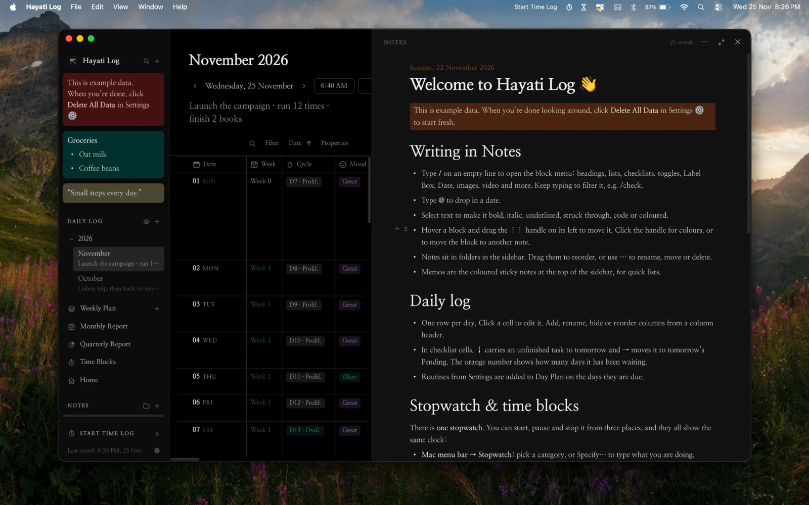

**A daily log, time tracker and life report in one desktop app.**
Plan your day, see where your time really goes, and spot the patterns behind your good and bad days, all on your own computer.

> **TL;DR**
> - 📝 Simple log. One row per day: plan, to-dos, mood, sleep, habits
> - ⏱️ A stopwatch, timer and note that lives in your **Mac menu bar** (Windows version less tested)
> - 🩸 Built-in **menstrual cycle** tracking
> - 🏷️ **Customisable patterns**: track behaviour, mood, health, lifestyle, anything, with an emoji
> - 📊 Monthly and quarterly reports that connect it all
> - 🔒 Your data stays **on your computer**. No account, no cloud.
> - 💾 Optional: Export to markdown or CSV for **Excel and Google Sheets**

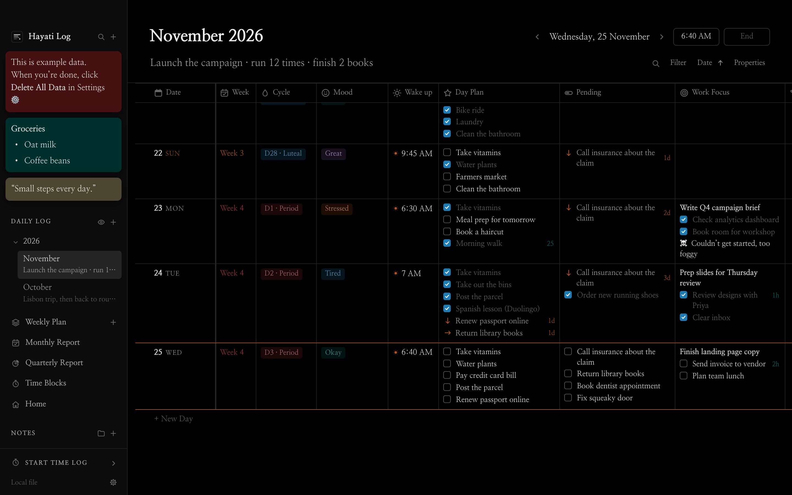

---

## 💛 Made for

- **ADHD brains:** see time, track procrastination and dopamine, get reminders.
- **Women:** see how each cycle phase really feels.
- **Anyone** tired of juggling five apps.

---

## ✨ Features

**⏱️ Menu bar stopwatch, timer and note.** One clock you can start from the menu bar, sidebar or any to-do. Every run becomes a time block. The note keeps today's focus in sight.

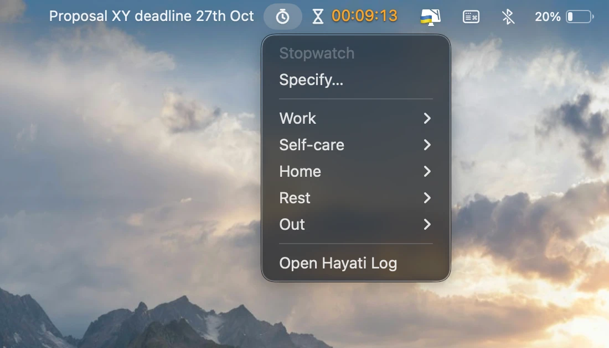

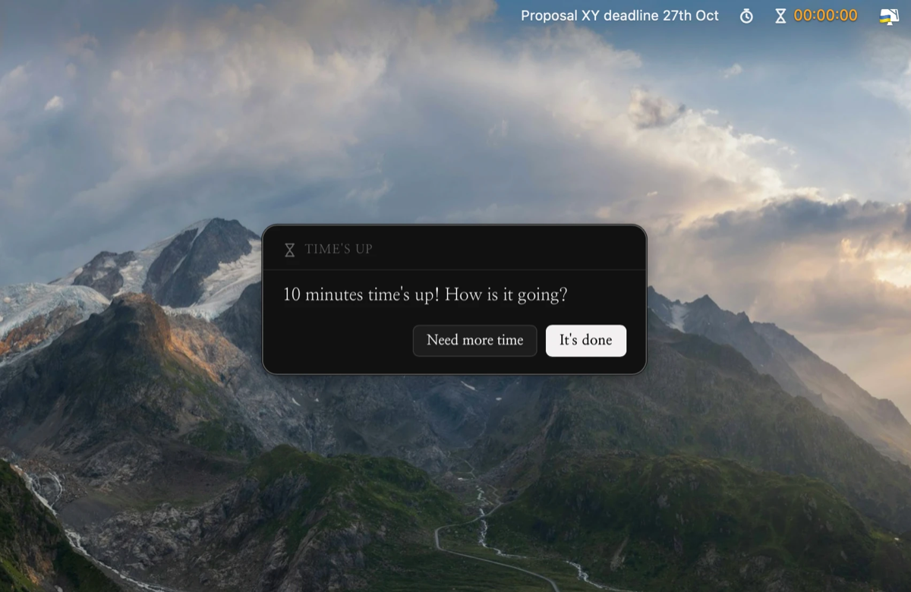

**🩸 Cycle tracking.** Mark your period start; the app counts days, shows phases and flags late periods.

**🧠 Mood and dopamine.** Rate each day. Name the options your way, like *High / Low dopamine* or *Brain fog*.

**🔁 Reminders.** Daily, weekly or monthly to-dos that appear in your Day Plan on their own.

**↓ → Procrastination, kindly.** Carry a task to tomorrow or park it in Pending. A counter shows how long it's waited.

**🏷️ Custom patterns.** Track anything with an emoji: 🤕 headaches, 📱 doom-scrolling, 🏝️ holidays.

**📊 Reports.** Monthly and quarterly views of habits, sleep, work vs rest, procrastination and your patterns, also by cycle phase.

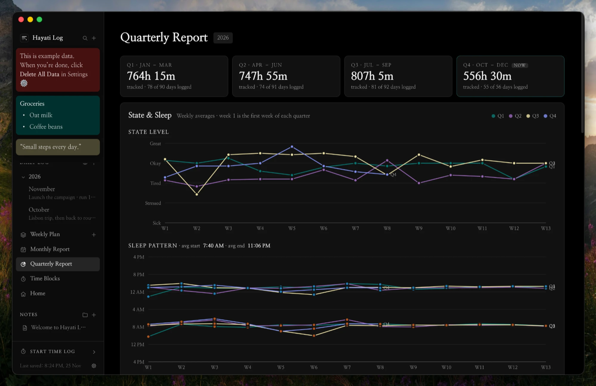

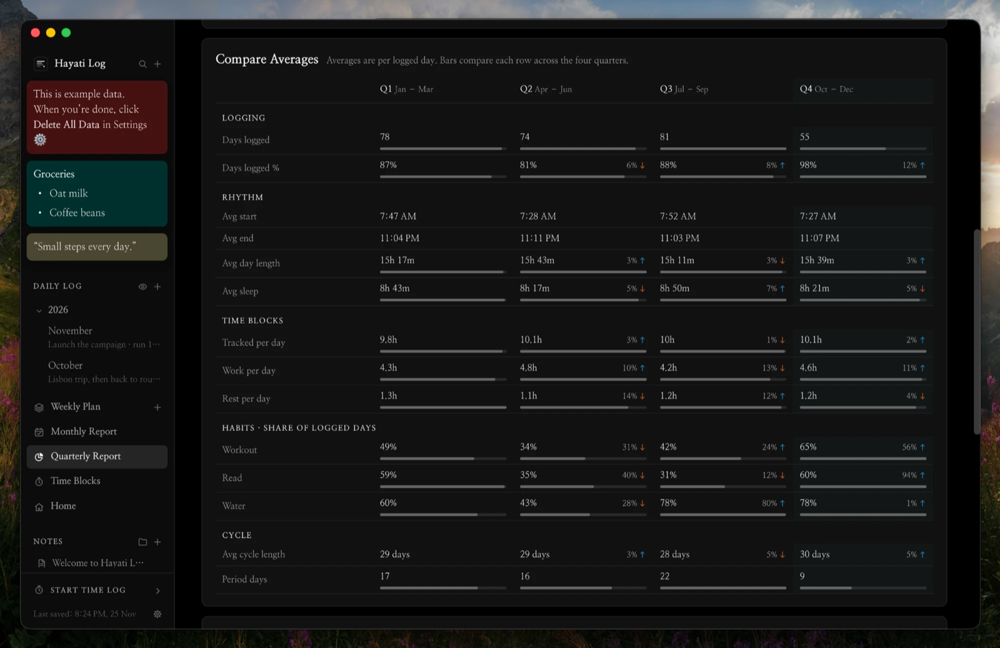

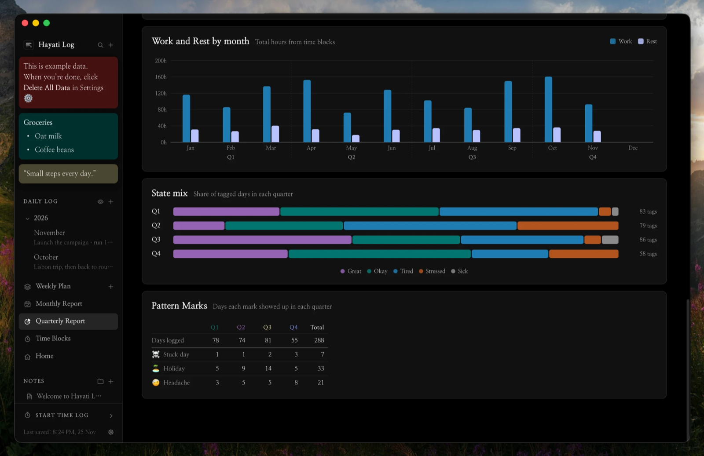

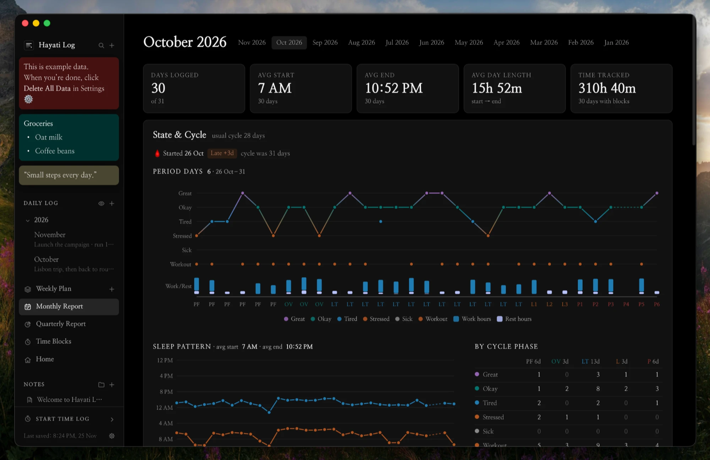

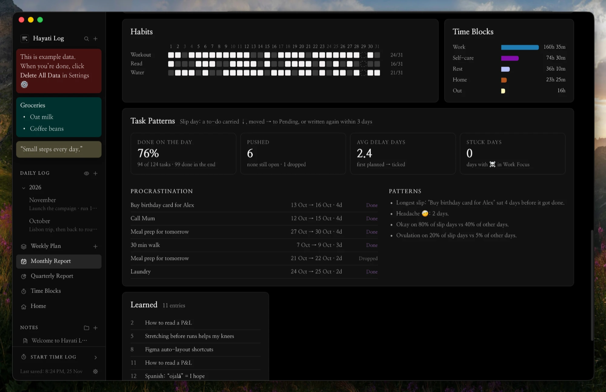

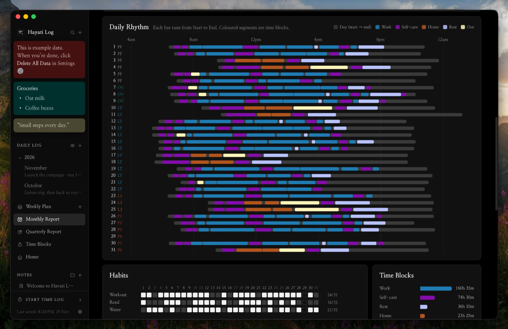

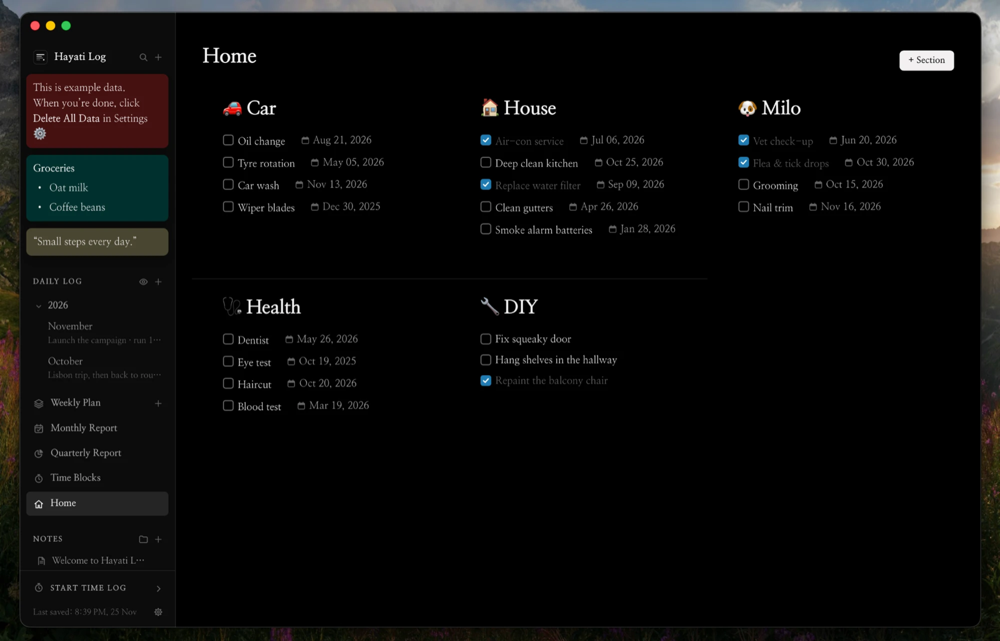

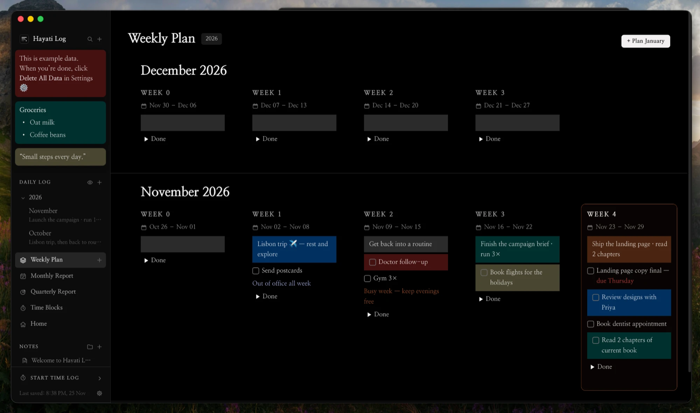

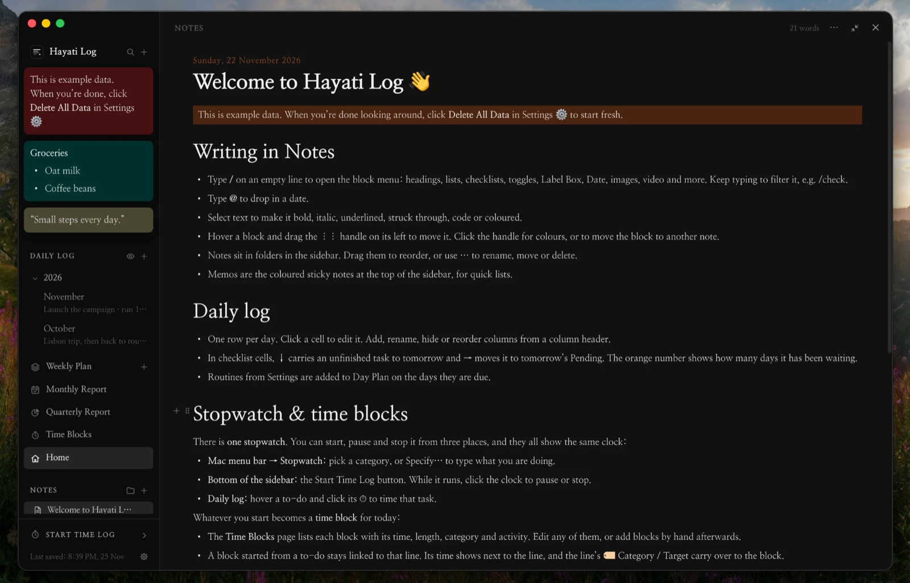

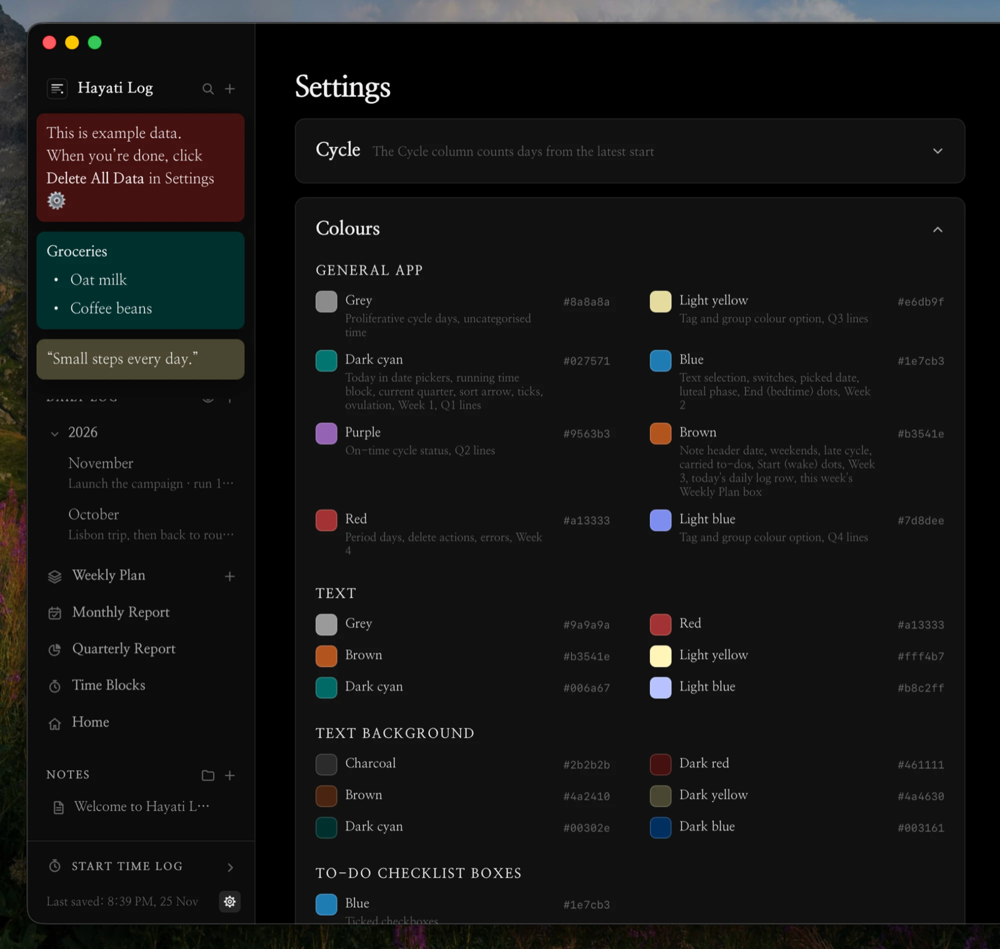

---

## 🚀 Get started

1. Download the latest from [**Releases**](https://github.com/hayatisaliman/Hayati-Log/releases/latest): `.dmg` for Mac (Apple Silicon), `-setup.exe` for Windows (less tested).
2. Open it. Explore the **example data** and read the **Welcome note**.
3. Ready? Go to Settings ⚙️ → Restore Data → **Delete All Data**, and start your first log.

---

## 🔒 Your data

- One file on your computer. No account, no cloud.
- Backed up daily (last 7 kept). Export to **CSV**, **JSON** or **Markdown** anytime.
- **⌘Z** undoes almost anything.

---

## 📄 License

[MIT](LICENSE). Free to use, change and share.

---

<details>
<summary><b>🛠️ For developers</b></summary>

### Run

```bash
npm install
npm run tauri:dev
```

`npm run dev` opens it in a browser at http://localhost:5188, reading and writing the same data file as the app.
Add `?demo` to the URL to load the example data without saving anything.

### Build

```bash
npm run tauri:build
```

- Mac app: `src-tauri/target/release/bundle/macos/Hayati Log.app`
- Mac installer: `src-tauri/target/release/bundle/dmg/Hayati Log_<version>_aarch64.dmg`
- Windows: GitHub **Actions → Windows build → Run workflow** (or push a `v*` tag), then download the `hayati-log-windows` artifact. On a Windows machine: `npm run tauri:build:win`.

Ready-made installers for the current version are kept in `release/`.

### Data notes

- Data file: `~/Library/Application Support/hayati.log/report.json` (Mac), `%APPDATA%\hayati.log\report.json` (Windows).
- Notes are stored one file per note in `notes/`, pasted images in `media/`.
- Only keep one copy open at a time (the app *or* the dev browser tab). Both write to the same file.
- Older versions used a `com.hayati.report` folder. The app renames it to `hayati.log` on first start.

### Import from AppFlowy

```bash
npm run import:appflowy -- --dry-run
npm run import:appflowy -- --force
```

Reads AppFlowy's local SQLite cache (read-only) and imports the monthly daily-log tables and time-block tables. `--force` replaces the current file, keeping a copy in `backups/` first.

### Layout

- `src/lib/` — time parsing, schema and colours, store, undo and saving, sample data
- `src/components/Table.jsx`, `cells.jsx` — the daily log table and its cells
- `src/components/TimeBlocks.jsx`, `TimeBlocksPage.jsx` — time blocks and stopwatch
- `src/components/MonthReport.jsx`, `QuarterReport.jsx`, `Procrastination.jsx` — reports
- `src/components/NoteEditor.jsx`, `NotePanel.jsx` — notes (also used by Weekly Plan and memos)
- `src/components/Sidebar.jsx`, `Settings.jsx` — sidebar and settings
- `src-tauri/` — desktop shell, menu bar (`menubar.rs`), Windows taskbar (`taskbar.rs`), saving and backups

</details>
